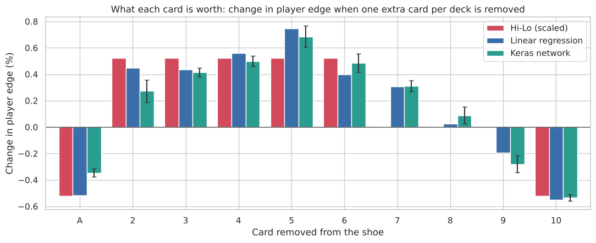

# Relearning the Count
### Can a neural network learn to count cards on its own?

Blackjack card counters use systems like Hi-Lo, which give each card a value (+1 for 2–6, −1 for 10s and aces). People worked those values out decades ago. I wanted to know whether a neural network, given nothing but raw game data, would figure them out on its own, and whether a reinforcement learning agent would learn to bet more when the deck is good without ever being told what counting is.



## What I did

1. **Wrote a blackjack simulator from scratch** with 6-deck Las Vegas–style rules and basic strategy, with unit tests for the rules. It measured a 0.78% house edge over 10M rounds, close to the published ~0.70% for these rules.
2. **Showed that counting works:** the player's edge rises from −2.8% at bad counts to +2.4% at a true count of +5 or more.
3. **Measured every card's value** with linear regression on 7.5M simulated rounds.
4. **Trained a Keras network** (running on a PyTorch backend) to learn card values from raw shoe data. To make the tiny signal learnable, I averaged 16 hands per shoe position, which cuts the noise by 4×.
5. **Trained a PyTorch reinforcement learning agent** (REINFORCE) that picks its own bet of 1–8 units and only sees its winnings.
6. **Compared every method head-to-head** on 2.5M unseen rounds, using paired comparisons on the same hands.

## Key findings

- **The network rediscovered card counting.** Its card values correlate 0.90 with Hi-Lo, and it also found what Hi-Lo leaves out: the 5 is the most valuable card, the 7 is positive, and the 9 is slightly negative.
- **The RL agent learned to count without being told.** Its average bet climbs from 1.4 units at a neutral count to 7.8 units at a true count of +4.
- **Every counting method beat flat betting.** Flat betting lost 0.77 units per 100 rounds. Linear regression beat Hi-Lo by a statistically clear margin, the network tied Hi-Lo, and the RL agent had the highest return per unit bet.
- **The edge is small and the swings are huge.** Even with an edge, about half of the simulated 100-hour sessions still finished behind.

## Run it

```bash
pip install -r requirements.txt
jupyter notebook card_counting.ipynb
```

The first run simulates about 20 million hands and caches them in `data/`. That took about 10 minutes on a 2-core machine; it's faster with more CPU cores. Later runs take about 3 minutes. No dataset download is needed. To check the simulator's rules, run `python test_blackjack.py`.

## Files

| File | What it is |
|---|---|
| `card_counting.ipynb` | The full analysis: code, charts and write-up |
| `blackjack.py` | The simulator: rules, basic strategy, shoe and hand logic |
| `test_blackjack.py` | Unit tests for the rules and strategy |
| `requirements.txt` | Python libraries needed |

## Tools

Python · PyTorch · Keras 3 · NumPy · pandas · Matplotlib · seaborn · multiprocessing
